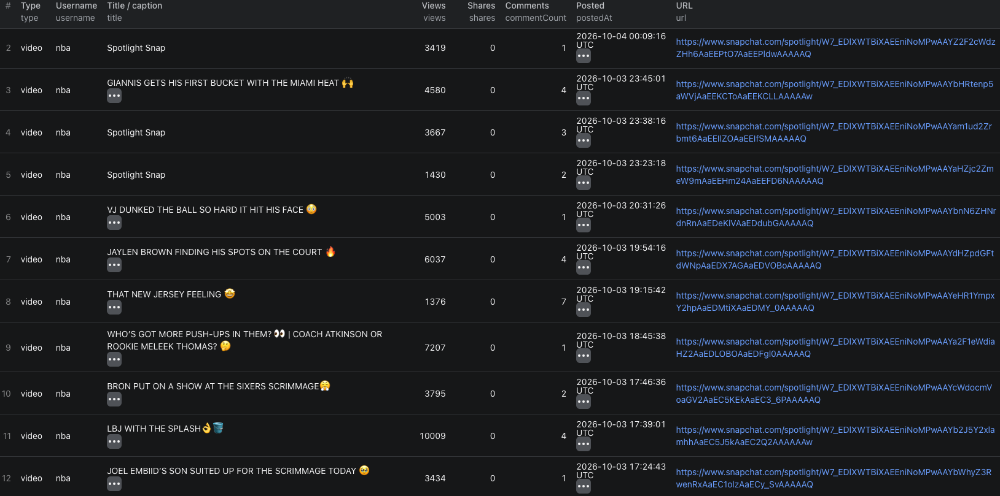

# How to Scrape Snapchat Profiles in Node.js

Use the [Snapchat Profile Scraper](https://apify.com/piotrv1001/snapchat-profile-scraper) through Apify's Node.js client. This example calls an existing Actor; it does not implement a Snapchat scraper.



The screenshot shows a larger `nba` run. The code below requests a smaller five-video sample.

## What this example does

- Calls the Actor with one public Snapchat username
- Limits recent videos and story snaps to five per profile
- Waits for the run to finish
- Fetches its dataset and prints the rows

## Prerequisites

Node.js, an Apify account, and an Apify API token.

## Installation

```bash
npm install
```

## Environment setup

Copy `.env.example` to `.env` and replace the sample token with your Apify API token.

## Usage

```bash
npm start
```

## Code example

```js
import { ApifyClient } from 'apify-client';
import 'dotenv/config';

// Initialize the ApifyClient with your Apify API token
// Set APIFY_TOKEN in your .env file (copy .env.example to get started)
const client = new ApifyClient({
    token: process.env.APIFY_TOKEN,
});

// Prepare Actor input
const input = {
    usernames: ['nba'],
    maxVideos: 5,
    includeTranscripts: false,
};

// Run the Actor and wait for it to finish
const run = await client.actor("piotrv1001/snapchat-profile-scraper").call(input);

// Fetch and print Actor results from the run's dataset (if any)
console.log('Results from dataset');
console.log(`💾 Check your data here: https://console.apify.com/storage/datasets/${run.defaultDatasetId}`);
const { items } = await client.dataset(run.defaultDatasetId).listItems();
items.forEach((item) => {
    console.dir(item);
});

// 📚 Want to learn more 📖? Go to → https://docs.apify.com/api/client/js/docs
```

## Example output

`sample-output.json` is an **illustrative shape**, not a captured run. A public profile row can contain a display name, bio, category, subscriber count, and website. Video rows can contain posting date, views, shares, comments, and a transcript when requested and available. Snapchat may omit fields.

## Use cases

- Compare a short list of public creator profiles
- Review recent Spotlight topics before outreach
- Export public subscriber counts and categories
- Track newly posted public videos in repeat runs

## Try the actor on Apify

**[Open the Snapchat Profile Scraper on Apify](https://apify.com/piotrv1001/snapchat-profile-scraper)**

## Related resources

- [How to Scrape Snapchat Profiles and Compare Creator Activity](https://www.falconscrape.com/blog/how-to-scrape-snapchat-profiles-and-spotlight-videos)

## License

MIT
